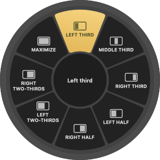

# Window management

Coconut-app can arrange a window while its native title bar or resize border is being dragged. Tap **Shift or Command on macOS**, or **Shift or Alt on Windows**, move over a wheel slice and release the mouse. Releasing the modifier keeps the wheel open. Releasing over the center/outside the wheel leaves placement unchanged. **Escape** dismisses the wheel until the next gesture.

The eight layouts are:

| Width | Position |
| --- | --- |
| 1/3 | Left, middle, right |
| 1/2 | Left, right |
| 2/3 | Left, right |
| 100% | Maximize |

**Maximize** fills the usable desktop without entering a separate full-screen space. You can drag the window again to choose another arrangement.

The preview and placement use the destination display's usable work area. The menu bar, Dock and taskbar are excluded. Adjacent regions share rounded pixel boundaries, including odd-width and Retina displays; screens left of or above the primary display keep their negative coordinates.

## macOS

Enable the feature in **Settings → General → Window management**. Use **Open permission settings…** and grant Coconut-app the window-control permission once. On macOS 27 the Privacy & Security pane is named **Device Control and Data Access** (**Aygıt Denetimi ve Veri Erişimi** in Turkish); earlier versions call it **Accessibility**. The button opens that pane directly. The app checks permission without prompting repeatedly; it never changes macOS privacy settings automatically. Accessibility APIs move and resize the window that was captured at the beginning of the drag.

Upgraded installations retain the `local.tangerine.replica` bundle identity to preserve update and user-data compatibility. macOS may cache the previous Tangerine display name in its Accessibility list; the reference app (`com.th.Tangerine`) is a separate permission. Coconut-app checks its own `AXIsProcessTrusted()` result. If an old row is enabled but Coconut-app still reports no access, use **Show Coconut-app in Finder** to select the current installed app when adding it through macOS settings. Coconut-app does not reset or edit the privacy database.

The window must actually move or resize before the wheel can activate. Fresh file/web drag payloads, a visible file wheel, editable text controls, scrollbars, minimized windows, full-screen windows and non-resizable/dialog windows are excluded. The overlay does not activate Coconut-app or capture mouse events from the app being dragged. No window titles, typed content or accessibility trees are recorded.

Some apps enforce minimum dimensions or disallow programmatic resizing. If the requested rectangle cannot be applied, Coconut-app reports it rather than claiming successful placement.

## Windows

The **Settings → General → Window management** checkbox enables/disables window management and persists outside the portable installation with the user's Coconut-app preferences. Native `MOVESIZESTART`/`MOVESIZEEND` events identify window gestures; no global keyboard hook or text monitoring is installed. The overlay is non-activating and passes pointer events through to the original app. DWM's invisible window borders are compensated so the visible frame aligns with the target area. Elevated/protected applications may reject resizing. A refused placement shows the same window-arrangement explanation as on macOS.

## Verification

- Swift regression tests cover all eight layouts, odd/Retina/negative screen coordinates, ordinary content drags, fresh-file precedence and Escape cancellation.
- The Windows core verifier covers the same partitions and preference persistence.
- The explicit macOS `--window-management-smoke <manager-pid> <output-directory>` mode runs from the installed Coconut-app identity after access is granted. It admits only a manager running that same executable and a newly launched disposable Coconut-app fixture. It tests all eight physical Shift/Command drags, releasing the modifier before mouse-up, and Escape cancellation. Input is released on failure or interruption; the fixture closes and the pointer is restored. Missing access fails before posting any input.
- The Windows native smoke test launches a separate disposable Coconut-app fixture process, applies all eight layouts using real window APIs, exercises real Shift/Alt title-bar drags, a resize-border drag and Escape, and captures the wheel. It does not move the user's other windows.
- macOS 0.7.6 (37) live verification passed ten checks in each of two fixture runs: ordinary windows and windows with a 1,000-point minimum width. Each run covered all eight layouts, including Maximize, a resize-border drag and Escape. Maximize filled the 1,920 × 963-point usable area at screen y = 30.
- The 0.7.5 macOS 27.0.1 baseline passed nine checks: all seven physical Shift/Command title-bar drags, a resize-border drag, modifier release before mouse-up, and Escape in the separate disposable fixture process. Visible work area was 1920 × 963 points, starting at screen y = 30. Permission remained enabled after replacing the locally signed app with the next build.
- Other display configurations are covered by geometry regressions; they have not all been exercised on physical displays. App-specific minimum sizes can still prevent a requested layout.
- `--hold-for-capture` adds a bounded six-second pause to the explicit smoke mode for visual QA. An explicit manager invocation with `--capture-window-wheel <directory>` captures its own live AppKit view once during selection. This does not record other windows or require Screen Recording access. The captured labels and fraction glyphs were inspected for clipping and alignment.

The image is a live AppKit view render captured during a native drag. Desktop compositing is outside this image; real placement and dismissal are verified by the native gesture checks.
